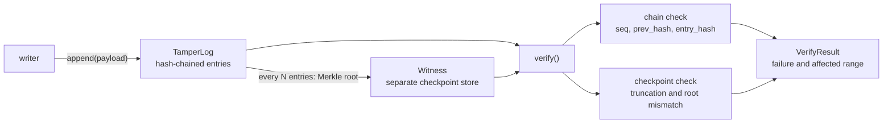

# tamperlog

A hash-chained audit log that also detects re-chained truncation, the attack plain hash chaining silently passes.

[](https://github.com/SlateGitOrg/tamperlog/actions/workflows/ci.yml)

## Why

Audit logs are the evidence used to reconstruct an incident, so anyone with write access to the log can defeat an investigation by editing it. Hash chaining is the usual defence, but it only proves internal consistency. An attacker who deletes the last 400 entries and re-chains the remainder, or edits a payload and recomputes the hashes, produces a log that a chain verifier declares valid. tamperlog adds periodic Merkle checkpoints whose roots are held in a separate witness store, so the verifier knows a checkpoint covering sequence N existed and can prove entries are missing or changed, and report the exact sequence range affected.

## Features

- Append-only log with per-entry hash chaining (SHA-256 over sequence, payload and previous hash) and a monotonic sequence number.
- Periodic Merkle checkpoints (configurable interval) recorded in a separate `Witness` store.
- Domain-separated leaf and node hashes, which blocks second-preimage forgery of inclusion proofs.
- Inclusion proofs for any entry, verifiable against a checkpoint root.
- Verifier that reports the failure kind and the affected sequence range.
- A tamper suite covering seven attack classes: in-place modification (naive and re-hashed), insertion, middle deletion, reordering, and naive and re-chained truncation.
- Standard library only, no dependencies.

## Architecture



`TamperLog` appends entries, each hashing its sequence number, payload and the previous entry's hash. Every `checkpoint_every` entries it computes a Merkle root over all entry hashes and records it in the `Witness`. `verify()` first runs the chain check, then recomputes the Merkle root for each witnessed checkpoint and compares. A missing tail shows up as a checkpoint beyond the end of the log; an edited entry shows up as a root mismatch.

## Quick start

Requires Python 3.11 or newer. Nothing to install.

```bash
git clone https://github.com/SlateGitOrg/tamperlog.git
cd tamperlog
python -m unittest discover -s tests -v   # run the tests
python -m src.demo                        # run the tamper comparison
```

## Example

`python -m src.demo` builds a 20,000-entry log with a checkpoint every 1,000 entries, applies each tamper, and compares the two verifiers:

```text
  Built a 20,000-entry log with 20 checkpoints in 0.11s
  Verified in 0.11s: log verified

  tamper                chain only    + checkpoints   affected range
  ------------------------------------------------------------------------
  modify                detected      detected        10001
  modify_rehashed       MISSED        detected        1-11000
  insert                detected      detected        10001-10002
  delete_middle         detected      detected        10001-10002
  reorder               detected      detected        10001-10002
  truncate_naive        MISSED        detected        19601-20000
  truncate_rechained    MISSED        detected        19601-20000
```

Timings are from one run on a laptop and will vary. Using the library directly:

```python
from src.log import TamperLog, Witness, verify

log = TamperLog(Witness(), checkpoint_every=100)
for i in range(1_000):
    log.append(f"event {i}".encode())

print(verify(log.entries, log.witness).describe())   # log verified
```

## How it works

- **Chain.** `entry_hash = SHA-256(seq || payload || prev_hash)`, starting from a zero genesis hash. This catches modification, insertion, deletion and reordering by an attacker who does not recompute hashes. It does not catch a plain tail truncation: dropping the last entries leaves a consistent chain, so only the checkpoints notice.
- **Checkpoints.** The Merkle root covers every entry hash up to the checkpoint sequence. If the attacker rewrites the log and re-chains it, the root over the surviving entries no longer matches the witnessed one; if the tail is gone, a checkpoint commits to entries that no longer exist.
- **Range reporting.** Truncation reports `len(entries)+1` through the first missing checkpoint sequence; a root mismatch reports `1` through the checkpoint sequence.
- **Merkle tree.** Leaves are `SHA-256(0x00 || data)` and internal nodes `SHA-256(0x01 || left || right)`; an odd node is promoted unchanged to the next level.
- **Witness separation.** The witness must live in a store the attacker cannot also rewrite. If it is co-located with the log, the guarantee reduces to plain chaining. In this repo the witness is an in-memory object standing in for that separate store.

More detail in [docs/ARCHITECTURE.md](docs/ARCHITECTURE.md).

## Testing

```bash
python -m unittest discover -s tests -v
```

The 17 tests cover the happy path (including a check that a verifier rejecting everything would fail), every tamper class with the exact affected range, the fact that chaining alone misses re-chained truncation and re-hashed edits, inclusion proofs (valid and wrong-entry), leaf and node domain separation, odd leaf counts, the empty-log root, and larger logs.

## Project layout

```text
src/log.py       entries, Merkle tree, Witness, TamperLog, verifiers
src/tamper.py    tamper classes and log builder
src/demo.py      chain-only versus chain-plus-checkpoint comparison
tests/           unittest suite
docs/            architecture notes
```

## Limitations

- Everything is in memory; there is no durable storage, and the witness is a local object rather than an external service.
- Entries appended after the last checkpoint can be removed undetected until the next checkpoint is recorded.
- Checkpoints are not signed, and there are no consistency proofs between checkpoints; verification recomputes each root in full, which is linear in log size per checkpoint.
- Educational implementation, not audited for production use.

## License

MIT, see [LICENSE](LICENSE).
