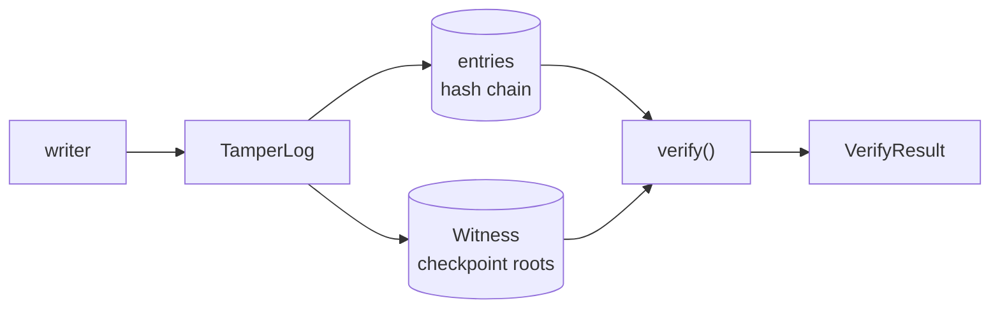

# Architecture

## Context

Audit logs record who did what, and they are the first thing consulted after an incident. Anyone able to write to the log can also edit it, so the log needs to make edits detectable. The usual answer is a hash chain; this project documents where that falls short and closes the gap.

## Container view

- `TamperLog` (`src/log.py`) holds the ordered entries and records a checkpoint every `checkpoint_every` appends.
- `Witness` stores `Checkpoint(seq, root, entry_count)` records, keyed by sequence.
- `verify_chain_only()` is the plain chain verifier; `verify()` adds checkpoint consistency.
- `src/tamper.py` implements the seven attacks used by the tests and the demo.

## Key decisions

**Merkle checkpoints in a separate witness.** A chain verifier checks that entries agree with each other, not that none are missing. A checkpoint is a commitment made earlier, outside the attacker's reach, so truncation and re-chained edits contradict it. The trade-off is the dependency on a second store: if an attacker can rewrite both, the guarantee collapses to plain chaining. This is stated in the README rather than implied away.

**Domain-separated hashing.** Leaves and internal nodes use different prefixes (`0x00` and `0x01`) so an internal node cannot be presented as a leaf in an inclusion proof.

**Report a range, not a boolean.** `VerifyResult` carries the failure kind and the affected sequence range, normalised so that it always reads low to high.

**Verifier ordering.** The chain check runs first, so cheap in-chain failures report an exact entry. Checkpoint checks run afterwards and report the checkpoint-granularity range.

## Failure modes

- Chain break, hash mismatch or sequence discontinuity: reported at the exact entry.
- A checkpoint beyond the end of the log: reported as truncation, from the first missing sequence to the checkpoint.
- A recomputed root that differs from the witnessed one: reported as a checkpoint root mismatch from entry 1 to the checkpoint.
- Entries added after the last checkpoint and then removed are not detectable until a later checkpoint is recorded.

## Out of scope

Durable storage, signing or authenticating checkpoints, consistency proofs between checkpoints, and distributing the witness across parties.
